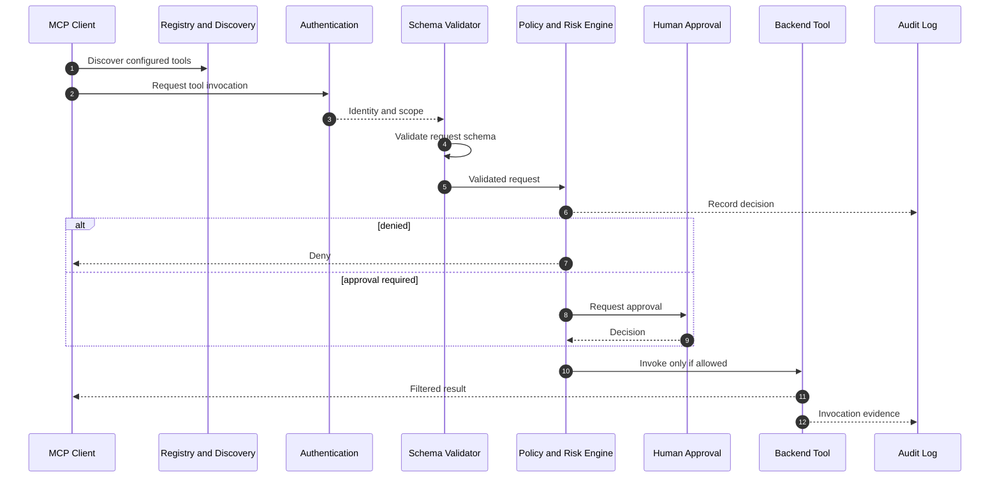

# x4-mcp-gateway

**Policy-controlled MCP gateway and registry**

Authentication • Authorization • Schema validation • Rate limiting • Approval gates • Audit

[](LICENSE)
[](CHANGELOG.md)

Part of **[ARIEX4Ops / X4](https://github.com/dhe-cruzer69)**.

---

## Thesis

A secure MCP gateway is not just a proxy. It is a control plane.

```
MCP Client
    ↓
Authentication
    ↓
Server Registry + Tool Discovery
    ↓
Schema Validation
    ↓
Policy Engine + Risk Engine
    ├─ DENY
    ├─ ALLOW
    └─ REQUIRE HUMAN APPROVAL
    ↓
Tool Invocation → Result Filter → Audit Log
```

<!-- X4-APEX-DIAGRAM-START:x4-mcp-gateway -->



<!-- X4-APEX-DIAGRAM-END:x4-mcp-gateway -->

## Example policy

```yaml
policy:
  name: production-github
rules:
  - tool: github.delete_repository
    action: deny
  - tool: github.create_issue
    action: allow
  - tool: github.merge_pull_request
    action: approval_required
```

Full architecture in [ARCHITECTURE.md](ARCHITECTURE.md).

## Related

- [x4-agents](https://github.com/dhe-cruzer69/x4-agents)
- [x4-sandbox](https://github.com/dhe-cruzer69/x4-sandbox)
- [x4-core](https://github.com/dhe-cruzer69/x4-core)

## License

Apache-2.0

## Security

See [SECURITY.md](SECURITY.md).

## Support

**[GitHub Sponsors](https://github.com/sponsors/dhe-cruzer69)**

## APEX Architecture Map

> Status: architecture documentation; implementation and deployment claims require independent verification.

**Evidence note:** Transport support, authentication, scope enforcement, argument validation, and audit behavior must be confirmed from the actual gateway implementation.

